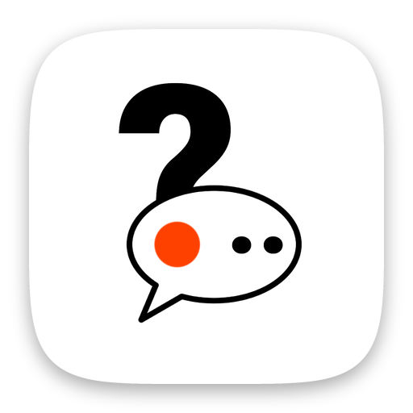

  

<h1 align="center">Trivia Player</h1>

Live pub-quiz trivia. Everyone gets the same question at the same time and types the answer into a shared chat.

  
  &nbsp;
  

Flutter · Firebase Realtime Database · RevenueCat · AdMob

## About the code

I built it in 2025 together with AI coding assistants.

The Cloud Functions backend and the sounds are not included.

## Known issues

- There are no automated tests yet.
- `flutter analyze` reports unused imports and a few type and deprecation warnings.

© 2025 Indest OÜ. All rights reserved.

Files with the Flutter project authors' header come from [Flutter's casual games template](https://github.com/flutter/games) and keep its BSD license ([third_party/flutter-games/LICENSE](third_party/flutter-games/LICENSE)). The fonts use the SIL Open Font License.
